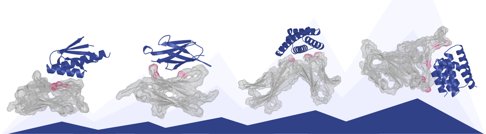

# Psi

[Link to white paper](https://dynopsi.dynotx.com/dynopsi_whitepaper.pdf)

Users of `dynopsi==1.0.0` start at [MIGRATION.md](https://github.com/dynotx/dynopsi/blob/main/MIGRATION.md).

This repository enables inference and sampling for Cicada, the default Psi model (Psi-1.5 Cicada). Psi is a family of *de novo* miniprotein binder design models developed by Dyno Therapeutics. The binder design pipeline is configurable and modular, supporting binder generation against both single and multi-chain targets. Backbone atom coordinates are output for each designed binder and can be exported in multiple formats for downstream analysis. [ProteinMPNN](https://github.com/dauparas/ProteinMPNN) is recommended to generate accompanying sequences, and recommended settings are provided below [in the sequence design section](#sequence-design-with-proteinmpnn).

`dynopsi` 2.0.0 is the package; the default model is Psi-1.5 Cicada. Psi-1 remains `checkpoint: v1`.
Cicada is the recommended starting checkpoint. See [Checkpoints](#checkpoints).

Psi model checkpoints and supplementary datasets are hosted on Hugging Face
[](https://huggingface.co/dynotx).
You can also run inference through [Phi](https://dynophi.com), Dyno's hosted service.

## Installation

### Requirements

- Python 3.12 (`>=3.12,<3.13`)
- CUDA-enabled GPU

### Setup

```bash
pip install dynopsi==2.0.0
```

Download the versioned example configuration used by the CLI commands below:

```bash
curl --fail --location \
    --output il7ra_3di3_config.yaml \
    https://raw.githubusercontent.com/dynotx/dynopsi/v2.0.0/example/configurations/il7ra_3di3_config.yaml
```

An unpinned install in Python 3.12 upgrades to 2.0.0 and changes the default weights to Cicada. Version 1.0.0 runs on Python 3.10; pin `dynopsi==1.0.0` there to keep it.

## Overview

A binder design run is defined by a configuration, specified as a YAML file or directly in Python. The example below demonstrates both options, and a more detailed explanation of possible configurations can be found in [`example/README.md`](https://github.com/dynotx/dynopsi/blob/main/example/README.md). The configuration contains sections for defining featurization parameters (e.g. binder lengths, target crops, hotspot residues), simulation parameters (e.g. ODE/SDE solvers, time schedules), and output formats and file locations. The input features to the model defined by the configuration can be viewed and validated before starting sampling. Generated structures can be used as the inputs to subsequent sequence design and filtering steps (performed outside of this package).
Each step is described in more detail in the sections below:

1. [Configuration](#configuration)
    1. [Featurization](#featurization)
        1. [Binder center of mass](#binder-center-of-mass)
    2. [Simulation](#simulation)
        1. [Checkpoints](#checkpoints)
    3. [Output](#output-configuration)
    4. [Putting it all together](#putting-it-all-together)
2. [Input Validation](#check-design-pipeline)
3. [Backbone Generation!](#run-design-pipeline)
4. [Sequence Design with ProteinMPNN](#sequence-design-with-proteinmpnn)
5. [Filter Designs](#filter-designs)

## Configuration

The design pipeline consists of three separately configurable components, which you can choose to configure as a YAML file or directly in Python. These are
(1) [Featurization](#featurization), (2) [Simulation](#simulation), and (3) [Output Configuration](#output-configuration).

### Featurization

This is where you provide a target, optionally crop your target, and specify hotspots. For the target, you can provide either an RCSB record ID, an AFDB ID, or a local path to a structure file. For the first two options, the structure will be downloaded. For binder chains to be designed, you must specify the desired length (or multiple lengths) and how to place the binder center of mass, either a coordinate you supply or an estimator from the hotspot geometry. There is no default center. The examples use a coordinate you pick in a viewer such as PyMOL. See [Binder center of mass](#binder-center-of-mass).

### Required inputs to featurization

- `name` : A user-readable name that defines this featurization setup.
- Define your target structure with exactly one of the following:
  - `rcsb_record_id` : The RCSB ID of your target; it will be downloaded from the RCSB PDB. This requires an internet connection.
  - `afdb_uniprot_id` : The Uniprot ID of the target; it will be downloaded from AFDB (v6). All isoforms are allowed (e.g. P16871, P16871-2). This requires an internet connection.
  - `structure_path` : Local path to the target structure, in .pdb or .mmcif format.
- Define the chain ID / indexing strategy used for the featurization specification
  - `index_type` : Which index strategy is used. Options are `original_residue_index`, `auth_residue_index`, described below:
    - `auth_residue_index`: Use the Author-defined indexing: residue indices and chain IDs are defined by the author of the deposited structure file.
    - `original_residue_index`: Use standard PDB indexing: all residue indices start at 1 within each chain and the chain ID is the standard PDB chain ID.

    We recommend loading your structure in [Mol*Viewer](https://molstar.org/viewer/) to select chains and indices. Mol*Viewer explicitly annotates with "AUTH" in scenarios where the author-defined chain ID and residue indexing diverges from standard PDB indexing.

    It is strongly recommended that you [check](#check-design-pipeline) the output featurization before generating designs to make sure that you have defined the correct chain/index parameters, especially if you use `auth_residue_index`.

Four additional featurization arguments shape the fanout: `crops`, `hotspots`, `new_chains_lengths`, and `new_chains_centers_of_mass`. Omit `crops` to use the whole structure; the other three must be non-empty. Each accepts multiple configurations. Their Cartesian product yields one featurization per combination, and each combination is simulated sequentially.

- `crops` : A dictionary of {crop_name : crop_range}.
- `hotspots` : A dictionary of {hotspot_name : hotspot_positions}.
- `new_chains_lengths` : A list of different chain lengths to generate.
- `new_chains_centers_of_mass` : A dictionary of {center_name : center_of_mass_function}.

### An example

The same binder design task can be specified using either YAML or Python.

YAML version:

```yaml
featurization_pipelines:
    il7ra_3di3_binder_design:  # name this something unique
        type: dynopsi_binder_design_featurization_pipeline  # this is the only option currently supported
        index_type: auth_residue_index  # `auth_residue_index` or `original_residue_index`
        rcsb_record_id: 3di3
        # afdb_uniprot_id: P16871
        # structure_path: /path/to/pdb_or_cif/file
        crops:
            crop_17_209: B17-209  # name crop_17_209 can be whatever you want
        hotspots:
            hotspot_58V_80L_139Y: B58,B80,B139  # name hotspot_58V_80L_139Y can be whatever you want
        binder_atoms_to_include: bb
        design_conditioning:
            chain_is_loopy:
                non_loopy: NON_LOOP
            has_homooligomer_partner:
                no_partner: NO_PARTNER
        new_chains_lengths: [60, 80, 100, 120] # produce binders of length 60, 80, 100, 120
        new_chains_centers_of_mass:
            il7center:  # name il7center can be whatever you want
                type: predefined_center_of_mass
                centers_of_mass: [[28.1, 41.4, 47.9]]
```

Python version:

```python
from dynopsi.data.constants import AtomFilter, DSSPLoopFeature, HomooligomerPartnerFeature
from dynopsi.data.featurization import DynoPsiBinderDesignFeaturizationPipeline, primitives

featurization_pipeline = DynoPsiBinderDesignFeaturizationPipeline(
    name="il7ra_3di3_binder_design",
    binder_atoms_to_include=AtomFilter.BB,
    index_type="auth_residue_index",
    rcsb_record_id="3di3",
    crops={"crop_17_209": "B17-209"},
    hotspots={"hotspot_58V_80L_139Y": "B58,B80,B139"},
    design_conditioning={
        "chain_is_loopy": {"non_loopy": DSSPLoopFeature.NON_LOOP},
        "has_homooligomer_partner": {"no_partner": HomooligomerPartnerFeature.NO_PARTNER},
    },
    new_chains_lengths=[60, 80, 100, 120],
    new_chains_centers_of_mass={
        "il7center": primitives.PredefinedCenterOfMassEstimator(centers_of_mass=[[28.1, 41.4, 47.9]])
    },
)
```

The loop label (`chain_is_loopy`) accepts `NON_LOOP`, `LOOP_OR_OTHER`, and `MASK_OR_MISSING`. The homooligomer-partner label (`has_homooligomer_partner`) accepts `NO_PARTNER`, `HAS_PARTNER`, and `MASK_OR_MISSING`. `MASK_OR_MISSING` is the mask (unspecified), not a fold or oligomeric state. For Cicada, the example uses the non-loop, no-partner values, a recommended starting point. Names under each key, such as `non_loopy`, are labels you choose. [`il7ra_3di3_loop_conditioning_config.yaml`](https://github.com/dynotx/dynopsi/blob/main/example/configurations/il7ra_3di3_loop_conditioning_config.yaml) sets `LOOP_OR_OTHER` with `NO_PARTNER`.

### Binder center of mass

Place the binder center with one of these types. `L` is the binder length in residues. The outward axis, used by the radius-of-gyration type, runs from the mean of the hotspot Cα together with resolved target Cα within 12 Å of the hotspot, through the hotspot mean.

- `predefined_center_of_mass`: the coordinate you supply is the center.
- `sphere_exclusion`: the center is placed from the hotspot geometry. The target standoff from hotspot Cα, in angstroms, is `D* = 2.2 · L^0.38 + 1.7 + exclusion_offset`. The placed center stays at least `R_excl` from resolved target Cα. `R_excl` equals `D*` unless you set `exclusion_radius`. `exclusion_offset` and `exclusion_radius` are optional.
- `estimate_binder_center_of_mass_radius_of_gyration`: the center sits on the outward axis, `2.11 · L^0.37 + 3.65` angstroms from the hotspot mean, clipped to `power_law_min_val`–`power_law_max_val` (5–30 Å by default). That distance estimates the binder radius of gyration. Optional overrides are `power_law_scale`, `power_law_exponent`, `power_law_offset`, `power_law_min_val`, and `power_law_max_val`. The `type` line alone is a complete entry.

```yaml
new_chains_centers_of_mass:
    excluded:
        type: sphere_exclusion
```

### Simulation

The simulation configuration controls the sampler, including which solver to use (ODE/SDE) and its parameters. Beyond the default solvers, sampling behavior can be customized by composing `Ops` — instructions that define the denoising trajectory — into a `Simulation` procedure. This can impose symmetry or otherwise modify the sampling dynamics. For miniprotein binder design, we recommend the following defaults:

YAML version:

```yaml
simulation_pipelines:
    sde_default:  # name this whatever you want
        type: sde_simulation  # supported types include `ode_simulation` and `sde_simulation`
        time_sampler:
            type: linear_time_sampler  # supported types include `linear_time_sampler` and `log_time_sampler`
            num_steps: 60
        self_conditioning_mode: previous_step
        diffusion_coefficient_fn:
            type: inverse_parameter
            eps: 0.01
            clamp_max: 10.0
        noise_scale_fn:
            type: constant
            constant: 0.3
        ode_warmup_score_scale_fn:
            type: constant
            constant: 1.0
        ode_warmup_max_t: 0.30
        ode_cooldown_score_scale_fn:
            type: constant
            constant: 1.3
        ode_cooldown_min_t: 0.87
```

Python version:

```python
from dynopsi.model.model_config import resolve_checkpoint
from dynopsi.simulation import LinearTimeSampler, SDESimulation
from dynopsi.utils import ConstantFunction, InverseParameterFunction

simulation = SDESimulation(
    name="sde_default",
    inference_model_config=resolve_checkpoint("v1.5-cicada"),
    time_sampler=LinearTimeSampler(num_steps=60),
    self_conditioning_mode="previous_step",
    diffusion_coefficient_fn=InverseParameterFunction(eps=0.01, clamp_max=10.0),
    noise_scale_fn=ConstantFunction(constant=0.3),
    ode_warmup_score_scale_fn=ConstantFunction(constant=1.0),
    ode_warmup_max_t=0.30,
    ode_cooldown_score_scale_fn=ConstantFunction(constant=1.3),
    ode_cooldown_min_t=0.87,
)
```

#### Checkpoints

The sampler fields above are the defaults for Psi-1.5 Cicada (`v1.5-cicada`, file `dynopsi-1.5-cicada.ckpt`). Sampling with Cicada requires a loop label (`chain_is_loopy`) and a homooligomer-partner label (`has_homooligomer_partner`); you set both, as in the [featurization example](#an-example). If you set neither `checkpoint:` nor `--checkpoint`, the run uses `v1.5-cicada`.

Psi-1 (`v1`, file `dynopsi-1.ckpt`) is the previous checkpoint. Set `checkpoint: v1` or pass `--checkpoint v1`. That checkpoint needs `self_conditioning_mode: same_timestep`, `num_steps: 100`, and `ode_warmup_max_t: 0.10`. Psi-1 has no loop or homooligomer-partner conditioning, so omit `design_conditioning`.

If you set both `checkpoint:` and `--checkpoint`, they must name the same weights. A YAML file cannot set `inference_model_config`; name the weights with `checkpoint:` there. In Python, pass `inference_model_config` or a checkpoint request, not both. To build the config yourself:

```python
from dynopsi.model.model_config import DynoPsiModelConfig, HuggingFaceLoaderConfig

inference_model_config = DynoPsiModelConfig(
    loader=HuggingFaceLoaderConfig(
        repo_id="dynotx/dynopsi",
        filename="dynopsi-1.5-cicada.ckpt",
    ),
)
```

Pass `revision` to pin a commit. Omitting it uses the current file on Hugging Face.

### Output Configuration

Set `formats`, the output directory, and whether to save the full sampling trajectory. The recommended list is `formats: [mmcif, npz]`. `mmcif` is a structure file written as `.cif`, and `pdb` is written as `.pdb`. `npz` is a structure archive and can accompany either structure format. `formats: [pdb, npz]` is still valid.

> **Note:** Saving trajectories requires significantly more time and disk space and is not recommended for large-scale runs.

YAML version:

```yaml
output_specifications:
    default_output_specification:
        output_dir: /path/to/outputs
        formats: [mmcif, npz]
        save_trajectory: False
```

Python version:

```python
from dynopsi import OutputSpecification

output_specification = OutputSpecification(
    output_dir="./example/output",
    formats=["mmcif", "npz"],
    save_trajectory=False,
)
```

### Putting it all together

Combine the pieces you specified above into a design pipeline.

YAML version:

```yaml
design_pipelines:
    il7ra_3di3_binder_design:
        featurization_pipeline: il7ra_3di3_binder_design
        simulation_pipeline: sde_default
        output_specification: default_output_specification
```

Python version:

```python
from dynopsi import DesignPipeline

design_pipeline = DesignPipeline(
    name="dynopsi_binder_design_pipeline",
    featurization_pipeline=featurization_pipeline,
    simulation_pipeline=simulation,
    output_specification=output_specification,
)
```

## Validate & Run a Design Pipeline

The `dynopsi` CLI command only supports calls to `.yaml` configurations, with examples shown below. If you prefer to run design pipelines via Python scripts, refer to the `.ipynb` examples in `example/notebooks/` for a starting point to define your own script.

### Check design pipeline

Dry run the design specification and verify that the solver configuration is valid. It is strongly recommended to run this validation and inspect your featurization, especially before long sampling runs.

Optional Arguments:

- `--format`: File format for the featurization preview written by `dynopsi check`. Accepted values are `pdb` and `cif`; the default is `pdb`. Sampling output formats are configured separately in the YAML output specification.
- `--overwrite`: Replace an existing `/path/to/outputs/<design_pipeline_name>/verify_configuration` directory. Without this flag, `dynopsi check` exits if that directory already exists.
- `--checkpoint`: Published checkpoint short name. If omitted, the checkpoint comes from the YAML configuration or defaults to `v1.5-cicada`.

CLI + YAML version:

```bash
dynopsi check il7ra_3di3_config.yaml
```

Python version:

```python
design_pipeline.verify_configuration()
```

View the featurization configuration (path below) in a structure viewer. Color by b-factor; this will show

| B Factor | Hotspot Feature                |
|----------|--------------------------------|
| 100      | hotspot                        |
| 50       | binder (center of mass)        |
| 0        | other target residues          |

```text
/path/to/outputs/
└── <design_pipeline_name>/
    └── verify_configuration/
        └── 3di3___crop_17_209___hotspot_58V_80L_139Y___length_<length>_il7center___non_loopy___no_partner___atoms_bb___features.pdb
```

### Run design pipeline

Optional arguments

- `--num_samples`: Number of designs generated for each combination in the Cartesian product; the default is `10`.
- `--overwrite`: Replace an existing `/path/to/outputs/<design_pipeline_name>/<simulation_name>` directory. Without this flag, `dynopsi sample` exits if that directory already exists.
- `--batch_size`: Batch size for inference. If omitted, it is inferred from memory on the single sampling device (`cuda:0` when CUDA is available, otherwise CPU): `5` for at least 80 GB, `2` for at least 40 GB, and `1` otherwise.
- `--checkpoint`: Published checkpoint short name. If omitted, the checkpoint comes from the YAML configuration or defaults to `v1.5-cicada`.

CLI + YAML version:

```bash
dynopsi sample il7ra_3di3_config.yaml --num_samples 10
```

Python version:

```python
design_pipeline.sample(num_samples=10)
```

### Inspect outputs

With `formats: [mmcif, npz]` and `save_trajectory: False`, the example writes a resolved configuration alongside one directory per featurization. The featurization directory name joins the structure, crop, hotspot, length, center, conditioning labels, and atom set with `___`:

```text
/path/to/outputs/
└── <design_pipeline_name>/
    └── <simulation_name>/
        ├── resolved_design_config.json
        └── 3di3___crop_17_209___hotspot_58V_80L_139Y___length_<length>_il7center___non_loopy___no_partner___atoms_bb/
            ├── X_T_final_state_<sample_idx>.cif
            ├── X_T_final_state_<sample_idx>.npz
            └── observable_outputs_<sample_idx>.npz
```

`X_T_final_state_<sample_idx>.npz` is the final structure archive. `observable_outputs_<sample_idx>.npz` stores the sampler tensors recorded during inference, with arrays keyed by state, step, and modality.

When `save_trajectory` is True, that directory also contains `X_T_trajectory_<sample_idx>.cif` and `X_T_trajectory_<sample_idx>.npz`.

## Sequence design with ProteinMPNN

Cicada generates backbone (N, CA, C, O) coordinates for the binder, and preserves the original target sidechains. We recommend designing the binder sequence with target-aware [ProteinMPNN](https://github.com/dauparas/ProteinMPNN).

ProteinMPNN's single-structure input requires a PDB file, so set `formats: [pdb, npz]` for this sampling run or convert the generated CIF to PDB first. Replace the path and binder chain ID below with values for your design. `--pdb_path_chains "B"` designs chain B while holding the other chains fixed. The low sampling temperature favors designability over diversity.

```bash
python protein_mpnn_run.py \
    --model_name v_48_020 \
    --sampling_temp 0.0001 \
    --backbone_noise 0.0 \
    --omit_AAs C \
    --num_seq_per_target 4 \
    --use_soluble_model \
    --pdb_path_chains "B" \
    --pdb_path "/path/to/dynopsi_design.pdb" \
    --out_folder "/path/to/proteinmpnn_outputs"
```

To preserve selected positions in the designed binder chain, also pass `--fixed_positions_jsonl`. ProteinMPNN expects one JSON object per line, keyed by the PDB file stem and then the designed chain, for example `{"dynopsi_design": {"B": [1, 2, 3]}}` for `/path/to/dynopsi_design.pdb`.

## Filter designs

We strongly recommend that you refold designs with AlphaFold2 (AF2) and filter on binder and interface quality metrics. The white paper shows filtering results from refolding with AF2 monomer in initial guess mode with a target template provided and 3 recycles. The designed structures are compared to the refolded structures, and designs that satisfy the following constraints are retained.

1. Binder RMSD (designed complex vs. refolded complex) < 1 Angstrom
2. Binder pLDDT > 0.8
3. Inter-chain pAE (ipAE) < 10

The filter thresholds match the binder design in silico benchmarking thresholds from [Watson, Juergens, Bennett (2023)](https://doi.org/10.1038/s41586-023-06415-8).

The code below shows refolding with [ColabDesign](https://github.com/sokrypton/ColabDesign/tree/main). Replace the paths, chain IDs, and sequence with values for your design. Applying the Binder RMSD threshold additionally requires aligning the designed and refolded binder coordinates, for example with the Kabsch algorithm; that alignment is not shown here.

```python
from colabdesign.af import mk_afdesign_model

design_pdb = "/path/to/dynopsi_design.pdb"
target_chain_id = "A"
binder_chain_id = "B"
binder_sequence = "REPLACE_WITH_BINDER_SEQUENCE"

complex_prediction_model = mk_afdesign_model(
    protocol="binder",
    num_recycles=3,
    data_dir="/path/to/alphafold_weights",
    use_multimer=False,
    use_initial_guess=True,
    use_initial_atom_pos=False,
)

complex_prediction_model.prep_inputs(
    pdb_filename=design_pdb,
    target_chain=target_chain_id,
    binder_chain=binder_chain_id,
    use_binder_template=False,
    rm_target_seq=False,
    rm_target_sc=False,
    rm_template_ic=True,
)

models = ["model_1_ptm"]

complex_prediction_model.predict(
    seq=binder_sequence,
    models=models,
    num_models=len(models),
    sample_models=False,
    num_recycles=3,
    verbose=False,
)
```

## License

This package is released under the Apache License 2.0. See [LICENSE/](https://github.com/dynotx/dynopsi/tree/main/LICENSE), including [LICENSE/NOTICE](https://github.com/dynotx/dynopsi/blob/main/LICENSE/NOTICE) and [LICENSE/THIRD-PARTY-NOTICES](https://github.com/dynotx/dynopsi/blob/main/LICENSE/THIRD-PARTY-NOTICES).

## Citation

Cite the [white paper](https://dynopsi.dynotx.com/dynopsi_whitepaper.pdf).
